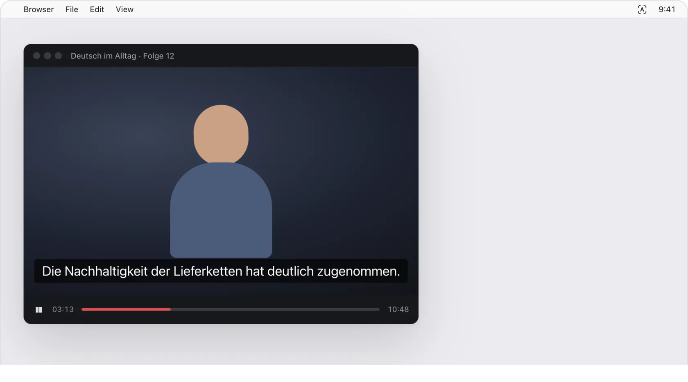
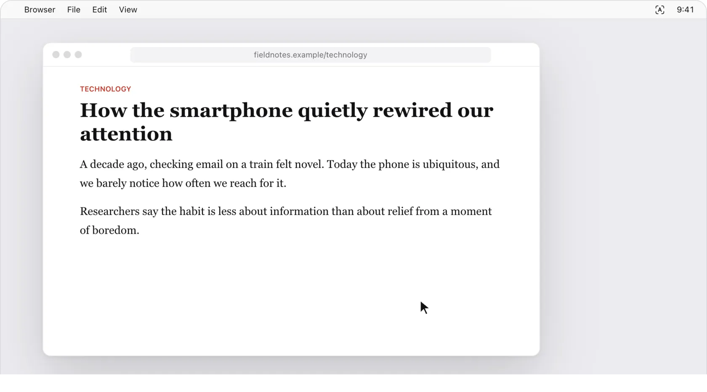
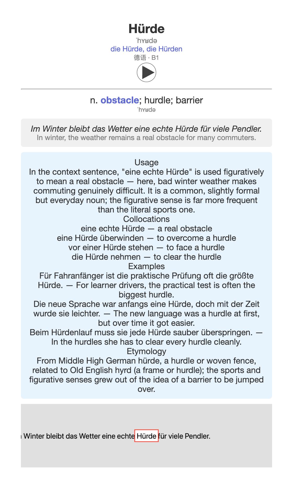
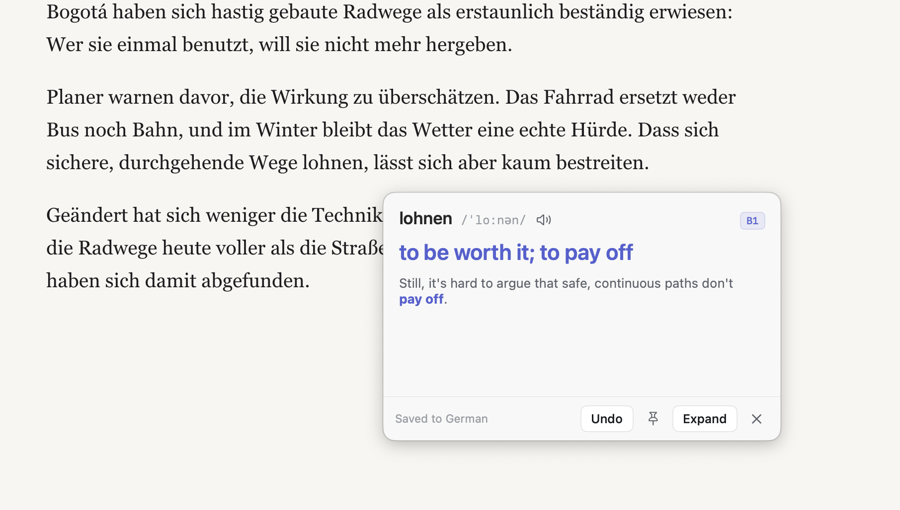
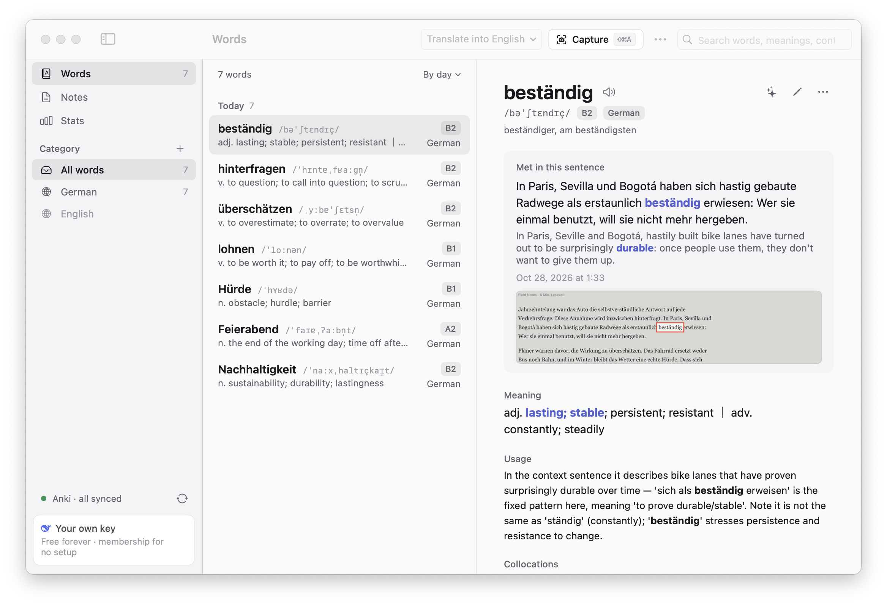

<p align="center"></p>

<h1 align="center">GetNewWord</h1>

<p align="center"><b>See a new word, frame it, get it: the AI reads the whole sentence, tells you what the word means right there, and files it in your library and Anki.</b></p>

<p align="center">
<a href="https://github.com/SchaeferAnjon/GetNewWord/releases/latest/download/GetNewWord.dmg"><b>Download for Mac</b></a> · Apple silicon and Intel · macOS 14 or later
</p>

<p align="center"><a href="https://getnewword.us-cloud.uk/?lang=en"></a></p>

<p align="center">
<a href="https://github.com/SchaeferAnjon/GetNewWord/releases/latest"></a>
<a href="LICENSE"></a>

</p>

<p align="center"><sub><b>English</b> · <a href="README.zh-CN.md">简体中文</a></sub></p>

<p align="center"></p>

## What it does

A word stops you in a video, a web page or a PDF. Press a shortcut and frame it: the AI reads the whole sentence, tells you what the word means in that sentence and translates the sentence the way a person would say it. The word goes into your library and becomes an Anki card for spaced repetition. The look-up panel never takes the keyboard, so Space still pauses your video.

- **Capture** <kbd>⇧</kbd> <kbd>⌘</kbd> <kbd>A</kbd>: frame a word or a sentence on screen. Frame a passage of explanation and it is saved as a note instead.
- **Point** <kbd>⌃</kbd> <kbd>⌘</kbd> <kbd>A</kbd>: rest the pointer on a word and press the shortcut, no framing.
- **Meaning in context**: the sense the word has in this sentence, the translation, usage, collocations, examples and word roots, and the sentence's grammar broken down when you ask.
- **Library**: categories, notes and stats, grouped by day, difficulty or category. Meet a word again somewhere else and both sentences are kept.
- **Anki**: decks follow your categories; Anki and its AnkiConnect add-on install from inside the app.
- **Translate into** Simplified or Traditional Chinese, English, German, French, Spanish, Japanese or Korean, from the main window toolbar.
- **App language**: Simplified Chinese, English or German, in **Settings › General**.
- **Updates itself**: it tells you when a new version is out and installs it with one click, or in the background if you switch that on.

## Point to look up

<p align="center"></p>

Watching a video with subtitles or reading a page, rest the pointer on a word and press <kbd>⌃</kbd> <kbd>⌘</kbd> <kbd>A</kbd>. GetNewWord reads the word under the pointer and its sentence, and the meaning pops up next to it. Press <kbd>Esc</kbd> or click anywhere else to close it, or pin it to keep it open.

Words looked up this way are not saved unless you switch on **Save words looked up by pointing** in **Settings › Shortcuts & capture**. Add <kbd>⌥</kbd> to the shortcut to do the opposite for one word.

## Anki cards

**Settings › Anki** sets it up in three steps: install Anki for Mac (free, about 230 MB), install the AnkiConnect add-on, then **Open Anki** or **Restart Anki** until it says connected. The welcome window offers the same steps; you can skip them.

After that every word you save becomes a card in the background. The front has the word, its phonetic spelling, its forms (for a noun, the article and the plural), its language and level, and plays the pronunciation; the back adds the meaning in this sentence, the sentence and its translation, usage, collocations, examples, word roots and the screenshot. The language name and the section labels follow the app language. Decks follow your categories. Anki has to be open; if it was closed, the waiting cards go out with the next word you save, or choose **⋯ › Sync Anki** in the main window (<kbd>⇧</kbd> <kbd>⌘</kbd> <kbd>S</kbd>).

<p align="center"></p>

## Screenshots

<p align="center"></p>

<p align="center"><picture><source media="(prefers-color-scheme: dark)" srcset="docs/readme/en/main-dark.png"></picture></p>

## Shortcuts

| | Default |
|---|---|
| Capture: frame a word or a passage, and save it | <kbd>⇧</kbd> <kbd>⌘</kbd> <kbd>A</kbd> |
| Capture without saving | <kbd>⌥</kbd> <kbd>⇧</kbd> <kbd>⌘</kbd> <kbd>A</kbd> |
| Point to look up | <kbd>⌃</kbd> <kbd>⌘</kbd> <kbd>A</kbd> |
| Point to look up, doing the opposite of the save switch | <kbd>⌃</kbd> <kbd>⌥</kbd> <kbd>⌘</kbd> <kbd>A</kbd> |
| Close the look-up panel | <kbd>Esc</kbd> |
| Sync Anki, in the main window | <kbd>⇧</kbd> <kbd>⌘</kbd> <kbd>S</kbd> |

Change the capture and point shortcuts in **Settings › Shortcuts & capture**; adding <kbd>⌥</kbd> keeps working with the new ones. Without a shortcut, start a capture from the menu bar icon or from the floating button on the edge of the screen.

## Two ways to use it

| | How to start | Cost |
|---|---|---|
| **Membership** | No key to set up: pick it in the welcome window or under **Settings › AI service**. Lookups use our AI (relayed by our server to DeepSeek) | The first 100 new users get **30 lookups free**, no expiry. Then $1.99 a month or $19.90 a year (¥9.9 or ¥99 in yuan), renewing through Stripe; cancel any time and it runs to the end of the period. Up to 200 lookups a day, reset at 8:00 Beijing time. Paying in yuan you can also buy 1 month or 1 year once with WeChat Pay, which doesn't renew. One licence code works on up to 2 Macs |
| **Your own key** | Paste a key from one AI provider in **Settings › AI service** ([setup guide](https://getnewword.us-cloud.uk/?lang=en#page=guide), about 5 minutes) | **Free forever, no limits**; the provider bills your own account at its prices |

**Manage your subscription** (change card, switch monthly and yearly, cancel, invoices): in the app, open **Settings › AI service**, click **Manage membership**, then **Manage subscription**. Not on that Mac any more? Use the [login link](https://billing.stripe.com/p/login/cNi4gse6y52b4sles72Nq01) and enter the email you paid with; Stripe sends you a sign-in email.

Providers: Zhipu GLM, DeepSeek, Qwen, Kimi and Doubao, which connect directly from mainland China; OpenAI, Gemini, Claude and OpenRouter, which need an overseas network there; or any OpenAI-compatible API (**Custom**). Each key is stored on its own in the macOS Keychain.

## Sync between Macs

Syncing your library between Macs is for members: sign in with Google under **Settings › Account & sync**. With your own key there is nothing to sign in to; every lookup feature works and your library stays on this Mac.

## Install

| | Download | Needs |
|---|---|---|
| **Mac** with Apple silicon or Intel | [`GetNewWord.dmg`](https://github.com/SchaeferAnjon/GetNewWord/releases/latest/download/GetNewWord.dmg) | macOS 14 or later |

Open the DMG and drag GetNewWord into Applications. It lives in the menu bar, a viewfinder with an A in it, and has no Dock icon; **Settings › General › Show icon in the Dock** adds one.

<details>
<summary>The first time you open it</summary>

- GetNewWord is not notarized by Apple, so the first time you open it macOS says it cannot verify the app and will not open it. Open **System Settings**, go to **Privacy & Security**, scroll to the bottom and click **Open Anyway**. You only do this once; updates installed automatically are not blocked.
- The welcome window has six steps: languages, Screen Recording, choosing membership or your own key, Anki (optional), anonymous statistics (agree or not) and the shortcuts.
- **Screen Recording** is the one permission GetNewWord needs, to capture the area you frame. Click **Allow**: System Settings opens at **Privacy & Security › Screen & System Audio Recording** (**Screen Recording** in older macOS) with the GetNewWord icon floating next to it. Drag the icon into the list, or switch GetNewWord on there. Then quit and reopen GetNewWord once; macOS only lets it capture after that.
- From macOS 15 on, macOS asks again about once a month whether GetNewWord may keep recording the screen. Click **Allow** (it may read **Allow For One Month**).
- It does not need the Accessibility permission.

</details>

<details>
<summary>Updating from a version before 1.2.0</summary>

Versions before 1.2.0 cannot update themselves: download [`GetNewWord.dmg`](https://github.com/SchaeferAnjon/GetNewWord/releases/latest/download/GetNewWord.dmg) once, replace the old app in Applications, and allow Screen Recording again, because 1.2.0 is signed with a different certificate.

</details>

## Privacy

The full policy is on the [website](https://getnewword.us-cloud.uk/?lang=en#page=privacy).

- No account needed, and we sell nothing.
- We give the first 100 users free credit, so we need to count how many people use the app. The count is anonymous: if you agree, the app sends once a day a random ID (made when you install it, not a hardware ID), the version, the system and chip, membership or your own key, and the app language; never the words you look up, your library, screenshots or keys. If you don't agree, nothing is sent; change it any time in **Settings › Updates & about › Anonymous usage statistics**.
- The screen is captured only when you look a word up (with a shortcut, the floating button or the menu bar menu), and only the area around the word is kept: with the word on your Mac and, if you use Anki, on the card.
- The framed area (as an image, or as text read on your Mac) and its sentence go to the AI service you choose: with your own key, straight from your Mac to that provider, under its privacy policy, and we never see them; with membership, through our server (api.us-cloud.uk) to DeepSeek; our server keeps only the time and how many requests and tokens each lookup used, to count lookups, not what you looked up. Membership registers this Mac once, with a hash of its hardware ID, not the ID itself; with your own key the Mac is not registered. Payments go through Stripe: we never see card numbers.
- To play a word, only that word is sent, to Youdao's dictionary, Wikimedia Commons or Google Translate. When none of them has it, your Mac's own voice reads it offline.
- Once a day the app downloads the update list from GitHub; it sends nothing about you. Installing Anki or AnkiConnect from the app downloads them from GitHub and AnkiWeb.
- Sync between Macs is for members and needs signing in. When signed in, the text of your library (words, sentences, notes and categories) is then stored on our sync server under your account, and audio and screenshots stay on your Mac. A signed-in Mac also records one "signed in" event and one "opened" event a day, so we know how many people use the app. These events are filed under your account, so they are not anonymous. Without signing in, nothing is recorded. To have your account and data on the server deleted, write from your login email to infoschaeferanjon@gmail.com.
- On your Mac, the library, screenshots, pronunciations, `app.log` and a backup made at every launch (the last 14 are kept) are in `~/Library/Application Support/GetNewWord/`. API keys are in the macOS Keychain.

## Build from source

```sh
brew install xcodegen
make dev
```

`make dev` builds **GetNewWord Dev**, a development copy with its own settings, data, Keychain entries and Anki decks, so it never touches the installed app. It signs with the maintainer's certificate, so without that certificate `make dev` fails: build with the ad-hoc signing in [docs/DEVELOPMENT.md](docs/DEVELOPMENT.md#build-and-run) instead. Releasing and the code layout are described there too.

## License

[GPL-3.0-or-later](LICENSE). Notices for the bundled third-party component (Sparkle) and the AI providers' trademarks are in [NOTICE](NOTICE).
