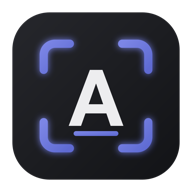
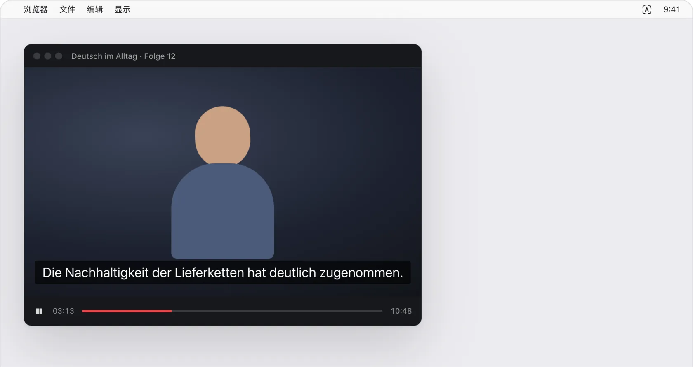
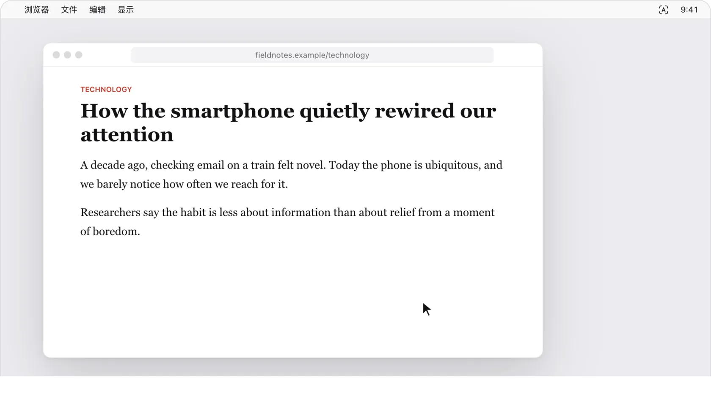
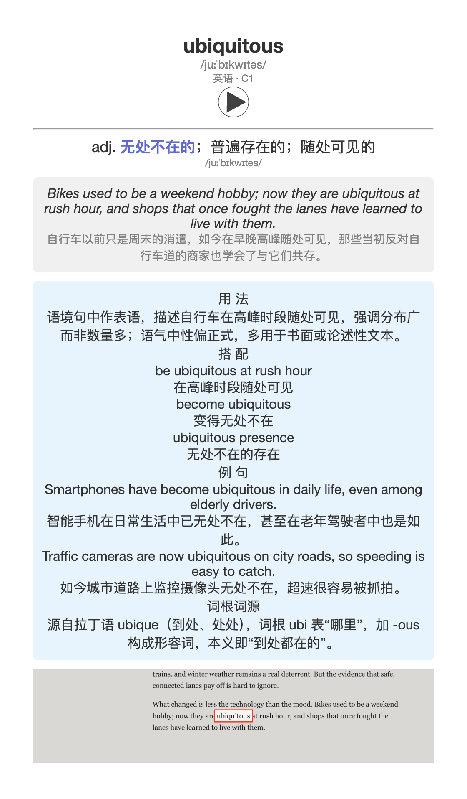
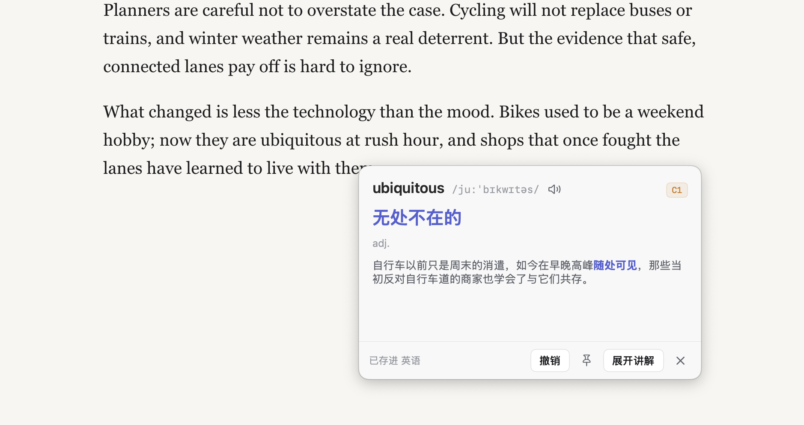
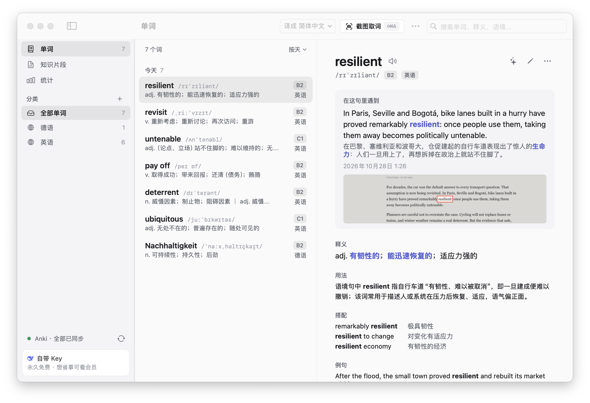

<p align="center"></p>

<h1 align="center">GetNewWord</h1>

<p align="center"><b>看到生词，框一下就懂：AI 读完整句，告诉你这个词在这里是什么意思，顺手存进词库和 Anki。</b></p>

<p align="center">
<a href="https://github.com/SchaeferAnjon/GetNewWord/releases/latest/download/GetNewWord.dmg"><b>下载 Mac 版</b></a> · Apple 芯片和 Intel 通用 · macOS 14 或更新
</p>

<p align="center"><a href="https://getnewword.us-cloud.uk/?lang=zh"></a></p>

<p align="center">
<a href="https://github.com/SchaeferAnjon/GetNewWord/releases/latest"></a>
<a href="LICENSE"></a>

</p>

<p align="center"><sub><a href="README.md">English</a> · <b>简体中文</b></sub></p>

<p align="center"></p>

## 它做什么

看视频、读网页、读 PDF 时遇到生词，按一下快捷键框住它：AI 读完整句，告诉你这个词在这句里是什么意思，再把整句译成人话。查过的词存进词库，变成 Anki 卡片按间隔复习。查词面板不抢键盘，空格照样暂停视频。

- **截图取词** <kbd>⇧</kbd> <kbd>⌘</kbd> <kbd>A</kbd>：框住屏幕上的一个词或一句话。框的是一段说明文字，就存成知识片段。
- **指词查词** <kbd>⌃</kbd> <kbd>⌘</kbd> <kbd>A</kbd>：鼠标停在词上直接按，不用框选。
- **按语境讲解**：这个词在这句里的义项、整句译文、用法、搭配、例句、词根词源，想看的话还能把整句语法拆开讲。
- **词库**：分类、知识片段、学习统计，可以按天、难度或分类分组。同一个词在不同地方遇到，几句语境都留着。
- **Anki**：牌组跟着分类走；Anki 和它的插件 AnkiConnect 都能在应用里一键装好。
- **译成哪种语言**：简体中文、繁體中文、English、Deutsch、Français、Español、日本語、한국어，在主窗口工具栏里换。
- **界面语言**：简体中文、English、Deutsch，在 **设置 › 通用** 里换。
- **自己更新**：有新版本会提示，一键下载替换；也可以打开后台自动下载安装。

## 指词查词

<p align="center"></p>

看带字幕的视频或读网页时，把鼠标停在词上，按 <kbd>⌃</kbd> <kbd>⌘</kbd> <kbd>A</kbd>。GetNewWord 认出鼠标下的词和它所在的句子，释义就弹在旁边。按 <kbd>Esc</kbd> 或点别处就关掉，想留着可以钉住。

这样查的词默认不进词库；想存，打开 **设置 › 快捷键与取词** 里的 **指词查词的词也加入词库**。快捷键多按一个 <kbd>⌥</kbd>，这一次就和开关反着来。

## 同步到 Anki

**设置 › Anki** 分三步接好：装 Anki 桌面版（免费，安装包约 230 MB），装 AnkiConnect 插件，再点 **打开 Anki** 或 **重启 Anki**，直到显示已连接。欢迎页里也有这一步，可以先跳过。

之后每存一个词，后台就建一张卡：正面是词、音标、词形（比如名词的冠词和复数）、语言和难度，还会读出发音；背面是这句里的意思、原句和译文、用法、搭配、例句、词源和截图，牌组跟着分类走。正面的语言名和背面的小标题跟着界面语言写。Anki 要开着；当时没开的话，等你存下一个词时会一起补上，也可以在主窗口点 **⋯ › 同步 Anki**（<kbd>⇧</kbd> <kbd>⌘</kbd> <kbd>S</kbd>）。

<p align="center"></p>

## 真机截图

<p align="center"></p>

<p align="center"><picture><source media="(prefers-color-scheme: dark)" srcset="docs/readme/zh/main-dark.png"></picture></p>

## 快捷键

| | 默认 |
|---|---|
| 截图取词：框住词或一段话，存进词库 | <kbd>⇧</kbd> <kbd>⌘</kbd> <kbd>A</kbd> |
| 截图取词，只查不存 | <kbd>⌥</kbd> <kbd>⇧</kbd> <kbd>⌘</kbd> <kbd>A</kbd> |
| 指词查词 | <kbd>⌃</kbd> <kbd>⌘</kbd> <kbd>A</kbd> |
| 指词查词，存不存和开关反着来 | <kbd>⌃</kbd> <kbd>⌥</kbd> <kbd>⌘</kbd> <kbd>A</kbd> |
| 关掉查词面板 | <kbd>Esc</kbd> |
| 同步 Anki（主窗口里） | <kbd>⇧</kbd> <kbd>⌘</kbd> <kbd>S</kbd> |

截图取词和指词查词的快捷键都能在 **设置 › 快捷键与取词** 里改，改完多按 <kbd>⌥</kbd> 照样有效。不想按快捷键，也可以从菜单栏图标或屏幕边上的悬浮按钮开始截图取词。

## 两种用法

| | 怎么开始 | 费用 |
|---|---|---|
| **会员** | 不用配 Key：在欢迎页或 **设置 › AI 服务** 里选会员。查词用我们的 AI（经我们的服务器转给 DeepSeek） | 前 100 位新用户**免费 30 次**，不过期。之后每月 ¥9.9 或每年 ¥99（美元 $1.99 或 $19.9），Stripe 自动续费，随时取消，用到这一期结束；每天最多 200 次，北京时间早上 8 点重置。人民币也能用微信一次买 1 个月或 1 年，不自动续费。一个授权码最多用在 2 台 Mac 上 |
| **自带 Key** | 在 **设置 › AI 服务** 里填一家 AI 的 Key（[配置教程](https://getnewword.us-cloud.uk/?lang=zh#page=guide)，大约 5 分钟） | **永久免费，不限次数**；费用按服务商的价格从你自己的账户扣 |

**管理订阅**（换卡、改月付年付、取消、看发票）：在应用里打开 **设置 › AI 服务**，点 **管理会员**，再点 **管理订阅**。没装应用或换了电脑，用[登录链接](https://billing.stripe.com/p/login/cNi4gse6y52b4sles72Nq01)，填付款时的邮箱，Stripe 会发一封登录信。

可选的服务商：智谱 GLM、DeepSeek、通义千问、Kimi、豆包，国内能直连；OpenAI、Gemini、Claude、OpenRouter，在国内需要海外网络；也可以接任何兼容 OpenAI 接口的服务（**自定义**）。每家的 Key 分开存在系统钥匙串里。

## 多台电脑同步

多台 Mac 之间同步词库是会员功能，在 **设置 › 账号与同步** 里用 Google 登录。自带 Key 不用登录，也能用全部查词功能，词库只存在这台 Mac 上。

## 安装

| | 下载 | 系统 |
|---|---|---|
| **Mac**，Apple 芯片和 Intel 芯片都行 | [`GetNewWord.dmg`](https://github.com/SchaeferAnjon/GetNewWord/releases/latest/download/GetNewWord.dmg) | macOS 14 或更新 |

打开 DMG，把 GetNewWord 拖进「应用程序」。它住在屏幕右上角的菜单栏里（取景框里一个 A），Dock 里没有图标；想在 Dock 里也看到，打开 **设置 › 通用 › Dock 里显示图标**。

<details>
<summary>第一次打开</summary>

- GetNewWord 没有经过苹果公证，第一次打开时 macOS 会提示无法验证、打不开：打开 **系统设置** 里的 **隐私与安全性**，拉到最下面点 **仍要打开**。只有第一次要这样，之后的自动更新不会再拦。
- 欢迎页一共六步：语言、屏幕录制权限、选会员或自带 Key、连接 Anki（可选）、匿名统计（同意或不用了）、快捷键。
- GetNewWord 只需要 **屏幕录制** 这一个权限，用来截下你框住的那一块。点 **授权**，系统设置会打开 **隐私与安全性 › 录屏与系统录音**（旧一点的 macOS 叫 **屏幕录制**），GetNewWord 的图标浮在旁边：把图标拖进列表，或者在列表里打开 GetNewWord 的开关。然后退出 GetNewWord 再打开一次，系统才让它截图。
- 从 macOS 15 起，系统大约每个月会再问一次要不要让 GetNewWord 继续录屏，点 **允许** 就行。
- 不需要辅助功能权限。

</details>

<details>
<summary>从 1.2.0 以前的版本升级</summary>

1.2.0 以前的版本不会自己更新：手动下载一次 [`GetNewWord.dmg`](https://github.com/SchaeferAnjon/GetNewWord/releases/latest/download/GetNewWord.dmg)，替换「应用程序」里的旧版，再重新给一次屏幕录制权限，因为 1.2.0 换了签名证书。

</details>

## 隐私

完整的隐私政策在[官网](https://getnewword.us-cloud.uk/?lang=zh#page=privacy)上。

- 不需要账号，我们不卖任何数据。
- 我们会给前 100 位用户免费额度，所以需要统计有多少人在用。统计是匿名的：你同意以后，应用每天发一次一个随机编号（装软件时生成，不是硬件编号）、版本号、系统和芯片、用会员还是自带 Key、界面语言；不发你查的词、词库、截图和 Key。不同意什么都不发，随时能在 **设置 › 更新与关于 › 匿名使用统计** 里改。
- 只有你取词时（按快捷键、点悬浮按钮或菜单栏里的取词）才截屏，而且只留词附近那一块：和单词一起存在你的电脑上，用了 Anki 的话也放进卡片。
- 框住的那一块（截图，或在你电脑上先认出的文字）和它所在的句子发给你选的 AI 服务：自带 Key 时从你的电脑直接发给那家服务商，受它的隐私政策约束，我们看不到；会员经我们的服务器（api.us-cloud.uk）转给 DeepSeek，服务器每次查词只记时间、请求次数和 token 数，用来计次数，不保存查了什么。用会员时这台 Mac 向服务器注册一次，发的是硬件编号的哈希，不是硬件编号本身；自带 Key 不注册。付款由 Stripe 处理，我们看不到卡号。
- 朗读单词时只发送这个词本身，发给有道词典、Wikimedia Commons 或 Google 翻译；都没有录音时，用 Mac 自带的语音在本机朗读。
- 应用每天去 GitHub 下载一次版本列表，看有没有新版本，不发送任何关于你的信息。在应用里一键安装 Anki 或 AnkiConnect 时，从 GitHub 和 AnkiWeb 下载。
- 多台电脑同步是会员功能，要登录。登录后词库里的文字（单词、语境、知识片段、分类）存在我们的同步服务器、你的账户下，发音和截图只留在你的电脑上。登录的电脑还会记一次「登录」，以后每天记一次「打开」，用来知道有多少人在用。这两个事件记在你的账户下，不是匿名的。不登录就不记。想删除服务器上的账户和数据，用登录的邮箱写信到 infoschaeferanjon@gmail.com。
- 在你的电脑上，词库、截图、发音、`app.log` 和每次启动时的自动备份（保留最近 14 份）都在 `~/Library/Application Support/GetNewWord/`；API Key 在系统钥匙串里。

## 从源码构建

```sh
brew install xcodegen
make dev
```

`make dev` 编出来的是 **GetNewWord Dev**：设置、数据、钥匙串和 Anki 牌组都和正式版分开，不会碰到装着的正式版。`make dev` 用作者的签名证书，没有这个证书会编不过，改用 [docs/DEVELOPMENT.md](docs/DEVELOPMENT.md#build-and-run)（英文）里的自签名（ad hoc）编法。怎么发版、代码目录也在那里。

## 许可证

[GPL-3.0-or-later](LICENSE)。安装包里带的第三方组件（Sparkle）的版权声明和各家 AI 的商标说明见 [NOTICE](NOTICE)。
